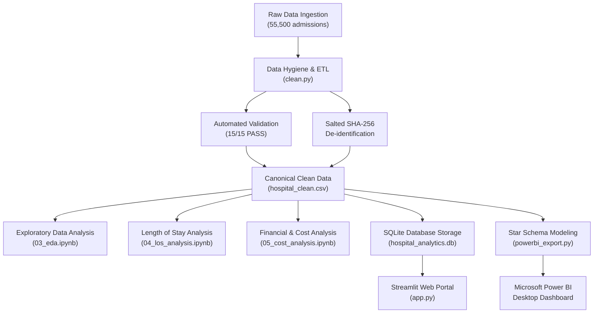

# 🏥 Hospital Patient Data Analysis & Executive Dashboard Portal

[](https://www.python.org/)
[](https://streamlit.io/)
[](https://powerbi.microsoft.com/)
[](https://www.sqlite.org/)
[](docs/privacy_and_ethics.md)
[]()

> **Project Type**: B.Tech Internship Project | Intermediate Level | Healthcare Operations Analytics  
> **Analytical Scope**: Strictly **Descriptive and Diagnostic Analytics** (No predictive modeling or machine learning).  
> **Target Audience**: Hospital Chief Executive Officers (CEOs), Medical Directors, Operations Heads, and Healthcare Financial Controllers.

---

## 📌 Table of Contents
1. [Project Overview](#-project-overview)
2. [Key Business Objectives](#-key-business-objectives)
3. [Empirical Insights & Key Findings](#-empirical-insights--key-findings)
4. [Technology Stack](#-technology-stack)
5. [Dataset Architecture & Privacy Protocol](#-dataset-architecture--privacy-protocol)
6. [Interactive Dashboards & Frontend Interfaces](#-interactive-dashboards--frontend-interfaces)
   - [A. Streamlit Web Portal](#a-streamlit-web-analytics-portal)
   - [B. Power BI Star Schema Dashboard](#b-power-bi-star-schema-dashboard)
7. [Repository Structure](#-repository-structure)
8. [End-to-End Analytical Workflow](#-end-to-end-analytical-workflow)
9. [Installation & Setup](#-installation--setup)
10. [How to Run](#-how-to-run)
11. [Data Governance & Ethical Declarations](#-data-governance--ethical-declarations)
12. [Author & Attribution](#-author--attribution)

---

## 🔍 Project Overview
Modern inpatient hospital networks face critical administrative hurdles in capacity planning, bed occupancy management, unexplained billing variations across commercial payers, and repeat patient hospitalizations. 

This repository delivers an end-to-end, enterprise-grade healthcare analytics solution and an interactive business intelligence suite using **55,500 patient admission records**. It bridges the gap between raw inpatient data and executive decision-making through:
* **Production-grade ETL pipeline** with automated deduplication and anomaly detection.
* **Cryptographic de-identification** via salted SHA-256 hashing to safeguard patient privacy.
* **Rigorous statistical hypothesis testing** ($\alpha = 0.05$) validating clinical throughput and cost drivers.
* **Dual-frontend delivery**: A dark-themed interactive **Streamlit Web Portal** and an enterprise **Power BI 4-Page Star Schema Dashboard**.

---

## 🎯 Key Business Objectives
The project is built around eight actionable operational objectives:
1. **Admission & Inpatient Census Trends**: Evaluate monthly seasonality, 3-month moving averages, and weekday vs. weekend intake velocity.
2. **Patient Demographic Profiling**: Stratify populations across canonical age groups (`0-17`, `18-34`, `35-49`, `50-64`, `65+`), gender parity, and blood types.
3. **Clinical Diagnoses & Outcomes**: Profile top medical conditions (Asthma, Cancer, Diabetes, Hypertension, Arthritis, Obesity), prescribed medications, and diagnostic test results (`Normal`, `Abnormal`, `Inconclusive`).
4. **Average Length of Stay (ALOS)**: Analyze mean and median stay duration, identifying extended-stay outliers (`long_stay_flag` $\ge 90\text{th}$ percentile = 27 days).
5. **Billing & Insurance Utilization**: Benchmark total ($1.404B CU) and daily charges across payers, identifying high-cost cases (`high_cost_flag` $\ge 95\text{th}$ percentile = 47,638.27 CU).
6. **30-Day Readmission Analysis**: Quantify derived proxy readmission rates across eligible stays (1.08% network baseline) and identify acuity risk drivers.
7. **Comparative Facility Benchmarking**: Evaluate provider performance applying strict sample size guardrails ($n \ge 30$).
8. **Interactive Executive Reporting**: Deliver multi-page business intelligence dashboards with dynamic cross-filtering.

---

## 💡 Empirical Insights & Key Findings

| Domain | Key Metric / Result | Code-Backed Operational Insight |
| :--- | :--- | :--- |
| **Data Hygiene** | **54,966 clean records** (40,235 unique patients) | 534 exact duplicates purged; 5,466 near-duplicates flagged without silent data loss. |
| **Privacy Audit** | **0 Leaks** across 71,197 indexed raw names | Automated regex & n-gram privacy scanner (`privacy_scan.py`) verified 100% compliance. |
| **Length of Stay** | **ALOS: 15.54 days** (Median: 16.00 days) | Non-parametric Kruskal-Wallis test showed stay duration does not differ significantly across admission acuity ($p = 0.1333$) or diagnoses ($p = 0.3901$). |
| **Cost Decoupling** | **$\rho = -0.0048, p = 0.2559$** | Length of stay is completely decoupled from total billing, indicating flat-rate diagnostic billing rather than per-diem operational charges. |
| **30-Day Readmission** | **1.08% overall** (580 / 53,566 eligible stays) | Emergency admissions exhibit a statistically significant higher readmission rate (**1.33%**) compared to Urgent (**0.89%**) and Elective (**1.03%**) ($\chi^2 = 16.31, p = 0.000288$). |
| **Payer Balance** | **$1.404 Billion Total Revenue** | Revenue is evenly distributed across 5 commercial/government payers (~$275M to $284M each; Kruskal-Wallis $p = 0.8261$). |

---

## 🛠️ Technology Stack
* **Core Language**: Python 3.10+ (tested on Python 3.11.9)
* **Data Processing & Manipulation**: `pandas==2.2.1`, `numpy==1.26.4`
* **Statistical Computation**: `scipy==1.17.1`, `statsmodels==0.15.0`
* **Visualization & Plotting**: `matplotlib==3.11.2`, `seaborn==0.13.2`, `plotly>=5.18.0`
* **Web UI & Interactive Portal**: `streamlit>=1.30.0`
* **Database & Persistence**: `sqlite3` (relational database engine)
* **Business Intelligence (BI)**: Microsoft Power BI Desktop (Star Schema Data Modeling & DAX)
* **Reproducible Notebooks**: Jupyter Notebook, `nbformat`, `nbclient`

---

## 📊 Dataset Architecture & Privacy Protocol

### Source vs. Canonical Schema

```text
Raw Source Columns (15)               Canonical Derived Dimensions & Flags (17)
─────────────────────────────────     ──────────────────────────────────────────
• Name (Dropped for privacy)       ─▶ • patient_key (Salted SHA-256 hash)
• Doctor (Dropped for privacy)     ─▶ • doctor_id (Deterministic DR-001, ...)
• Age                              ─▶ • age_group (0-17, 18-34, 35-49, 50-64, 65+)
• Gender                              • admission_id (Letter A + 6 digits)
• Blood Type                          • los_days (discharge_date - admission_date)
• Medical Condition                   • cost_per_day (billing_amount / max(los, 1))
• Date of Admission                   • admission_month / admission_year / weekday
• Discharge Date                      • long_stay_flag (los >= 27 days, 90th percentile)
• Billing Amount                      • high_cost_flag (billing >= 47,638 CU, 95th percentile)
• Room Number                         • readmitted_30d (0 to 30 days to next admission)
• Admission Type                      • readmission_eligible (discharge <= max_date - 30d)
• Insurance Provider                  • near_duplicate_flag (Flagged for audit)
• Medication / Test Results
```

### Cryptographic Privacy Guarantee
* **Zero Direct Identifiers**: Patient names are permanently purged after salted SHA-256 transformation (`internship-demo-salt`).
* **Automated Scanner**: `src/privacy_scan.py` executes before every delivery, verifying zero plaintext leaks across all `.csv`, `.md`, `.ipynb`, and `.py` files.

---

## 🖥️ Interactive Dashboards & Frontend Interfaces

### A. Streamlit Web Analytics Portal
A dark-themed, multi-page web application running locally via `streamlit run app.py`:
* **🏠 Portal Home**: Executive welcome landing page, overall network throughput counters, and direct navigation cards.
* **📊 Streamlit Analytics Workspace**:
  * **Dataset Management**: Drag-and-drop CSV uploader with **smart schema validation** (rejects non-healthcare CSVs with an explicit missing-columns alert).
  * **Persistent Storage**: Connected to a local SQLite database (`data/hospital_analytics.db`).
  * **Dynamic Sidebar Filters**: Date range slider, admission urgency, diagnosis, and insurance provider multi-selects.
  * **5 Dedicated Tabs**: Overview, Demographics, Clinical & Diagnoses, Cost & Readmissions, and Interactive Inpatient Data Explorer with CSV download.
* **📈 Power BI Dashboard Hub**: Specifications, direct download buttons for all 6 Star Schema tables, and DAX formula repository.

### B. Power BI Star Schema Dashboard
An executive 4-page business intelligence report built in Microsoft Power BI Desktop:
* **Page 1: Executive Overview** (KPI cards, monthly admissions trend, urgency donut, weekday intake).
* **Page 2: Patient Demographics Profile** (Age pyramid, gender split, blood type distribution, urgency mix).
* **Page 3: Clinical Diagnoses & Outcomes** (Diagnosis prevalence, test results stacked bars, medications treemap).
* **Page 4: Cost, Financials & Readmissions** (Billed charges by insurer, cost vs. LOS decoupling scatter, 30-day readmissions).

---

## 📁 Repository Structure

```text
Hospital_data_analysis/
├── data/
│   ├── raw/                        # Immutable, read-only raw Kaggle dataset (55,500 rows)
│   │   └── healthcare_dataset.csv
│   ├── processed/                  # Cleaned, anonymized canonical dataset (54,966 rows)
│   │   └── hospital_clean.csv
│   └── hospital_analytics.db       # Persistent SQLite database
├── notebooks/                      # Fully executed Jupyter notebooks (Phases 1-5)
│   ├── 01_data_inspection.ipynb   # Raw schema, cardinality & missingness audit
│   ├── 02_preprocessing.ipynb      # ETL cleaning, deduplication & canonical feature derivation
│   ├── 03_eda.ipynb                # Descriptive statistics, volume trends & demographic profiling
│   ├── 04_los_analysis.ipynb       # Length of stay distributions, bootstrapping & hypothesis tests
│   └── 05_cost_analysis.ipynb      # Financial analytics, payer breakdown & cost-LOS decoupling
├── powerbi/                        # Pre-engineered Star Schema tables for Power BI Desktop
│   ├── Fact_Admissions.csv         # Core inpatient admissions fact table (54,966 rows)
│   ├── Dim_Date.csv                # Continuous calendar dimension (2019-2024)
│   ├── Dim_Patient.csv             # 40,235 unique patients with age brackets
│   ├── Dim_Doctor.csv              # 40,341 pseudonymous physicians
│   ├── Dim_Hospital.csv            # Standardized facilities adhering to n >= 30 guardrail
│   └── Dim_Condition.csv           # Clinical conditions & specialty lookup proxies
├── src/                            # Modular, reproducible Python pipelines
│   ├── clean.py                    # Production ETL clean_dataset() pipeline
│   ├── database.py                 # SQLite database engine & schema validator
│   ├── powerbi_export.py           # Star Schema generator & exporter
│   ├── validate.py                 # 15-point automated data quality assertion suite
│   ├── privacy_scan.py            # Automated direct identifier leak audit (71,197 names)
│   ├── eda_analysis.py             # Phase 3 automated EDA execution engine
│   ├── los_analysis.py             # Phase 4 automated LOS statistical suite
│   └── cost_analysis.py            # Phase 5 automated financial statistical suite
├── docs/                           # Technical specifications & governance documentation
│   ├── problem_statement.md       # Problem charter, scope boundaries & 8 objectives
│   ├── data_dictionary.md         # Full variable dictionary with privacy classes
│   ├── data_dictionary.csv        # Machine-readable schema dictionary
│   ├── field_availability_matrix.md# Analytical mapping & missing field handling
│   ├── powerbi_guide.md           # Step-by-step Power BI tutorial & DAX catalog
│   ├── preprocessing_report.md    # Deduplication, transformation & outlier log
│   ├── privacy_and_ethics.md      # Salted SHA-256 protocol & zero-leak audit results
│   └── source_attribution.md      # Data provenance and synthetic dataset attribution
├── outputs/
│   ├── figures/                   # 30+ publication-grade 150-DPI analytical figures
│   └── tables/                    # Reconciled summary CSVs, stat tests & key findings
├── app.py                          # Streamlit multi-page enterprise web portal
├── run_dashboard.bat               # 1-click Windows batch launcher
├── requirements.txt               # Pinned Python package dependencies
└── README.md                      # Comprehensive project documentation
```

---

## 🔄 End-to-End Analytical Workflow



---

## ⚡ Installation & Setup

### 1. Prerequisites
* **Python**: Version 3.10 or higher.
* **Power BI Desktop**: Required only for opening `.pbix` reports (free on Windows).

### 2. Clone and Setup Environment
```bash
# Clone the repository
git clone https://github.com/your-username/Hospital_data_analysis.git
cd Hospital_data_analysis

# Create and activate virtual environment (recommended)
python -m venv venv

# Windows:
.\venv\Scripts\activate
# Linux / macOS:
source venv/bin/activate

# Install pinned dependencies
pip install -r requirements.txt
```

---

## 🚀 How to Run

### 1. Launch the Streamlit Web Application
You can run the web app with a single command:
```powershell
streamlit run app.py
```
*Or simply double-click [`run_dashboard.bat`](run_dashboard.bat) on Windows. The app will open at `http://localhost:8501`.*

### 2. Run the Automated Privacy Audit
```powershell
python src/privacy_scan.py
```

### 3. Run the Production Data Cleansing Pipeline
```powershell
python -c "import pandas as pd; from src.clean import clean_dataset; df = pd.read_csv('data/raw/healthcare_dataset.csv'); clean_df, _ = clean_dataset(df); clean_df.to_csv('data/processed/hospital_clean.csv', index=False); print('Cleaned rows:', len(clean_df))"
```

### 4. Regenerate Power BI Star Schema Tables
```powershell
python src/powerbi_export.py
```

### 5. Open & Explore in Power BI Desktop
1. Open **Power BI Desktop**.
2. Click **Get Data → Text/CSV** and select the 6 pre-built tables from `powerbi/`.
3. Follow the visual layout blueprints and copy-paste DAX formulas in [docs/powerbi_guide.md](docs/powerbi_guide.md).

---

## ⚖️ Data Governance & Ethical Declarations

* **Purely Descriptive & Diagnostic**: In strict adherence to academic guidelines, **no predictive machine learning models** (e.g., readmission risk scorers or length of stay regression estimators) are used.
* **Non-Causal Language**: All statistical findings describe empirical associations (*"is associated with"*, *"differs across"*); no clinical causal mechanisms are asserted.
* **Unavailable Fields Explicitly Documented**: Patient residential address (rural/urban), clinical department, procedure codes, native readmission flags, and payment status are unrecorded in the source dataset. Per our [Field Availability Matrix](docs/field_availability_matrix.md), **no synthetic variables have been invented**.
* **Zero Privacy Leakage**: Automated scanning verifies 100% compliance across all indexed identifiers.

---

## 👤 Author & Attribution

* **Project**: Hospital Patient Data Analysis and Dashboard Development Using Python and Power BI
* **Author**: B.Tech Intern (Healthcare Analytics)
* **Dataset Attribution**: Kaggle Healthcare Dataset by `prasad22` (Synthetic inpatient admission records).
* **Documentation & Audit**: Full audit logs and data dictionaries are available in [`docs/`](docs/).
* **License**: Intended for academic, research, and educational demonstration purposes.
