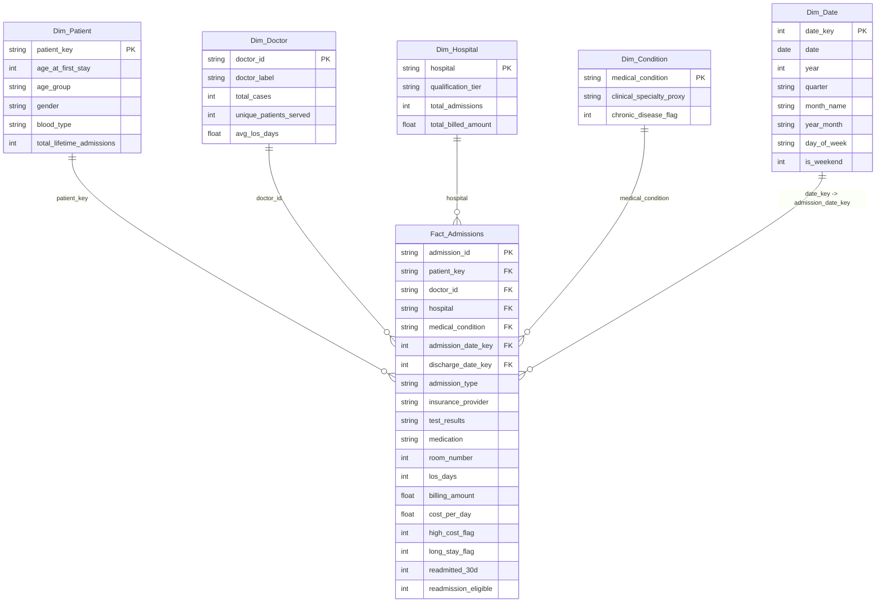

# Power BI Desktop Implementation & Dashboard Guide

This comprehensive guide walks you step-by-step through importing the prepared Star Schema datasets, establishing data model relationships, adding core DAX measures, and designing all 4 executive dashboard pages in **Power BI Desktop**.

---

## 1. Star Schema Architecture

All datasets are pre-engineered and exported in [`powerbi/`](file:///c:/Users/berab/OneDrive/Desktop/Hospital_data_analysis/powerbi/):



---

## 2. Step-by-Step Implementation in Power BI Desktop

### Step 1: Ingest Data
1. Launch **Power BI Desktop**.
2. Click **Get Data** (Home Ribbon) → Select **Text/CSV**.
3. Navigate to `c:\Users\berab\OneDrive\Desktop\Hospital_data_analysis\powerbi\` and load the 6 files:
   * `Fact_Admissions.csv`
   * `Dim_Date.csv`
   * `Dim_Patient.csv`
   * `Dim_Doctor.csv`
   * `Dim_Hospital.csv`
   * `Dim_Condition.csv`
4. Click **Load** (Transform Data is unnecessary as data is pre-cleaned).

---

### Step 2: Establish Model Relationships (Model View)
In the left sidebar, click the **Model View** (icon with 3 connected boxes) and verify the 1-to-many relationships (Single Cross-filter direction):

| From Table (Dimension) | Column | To Table (Fact) | Column | Cardinality | Direction |
| :--- | :--- | :--- | :--- | :--- | :--- |
| **Dim_Date** | `date_key` | **Fact_Admissions** | `admission_date_key` | 1 to Many (`1:*`) | Single |
| **Dim_Patient** | `patient_key` | **Fact_Admissions** | `patient_key` | 1 to Many (`1:*`) | Single |
| **Dim_Doctor** | `doctor_id` | **Fact_Admissions** | `doctor_id` | 1 to Many (`1:*`) | Single |
| **Dim_Hospital** | `hospital` | **Fact_Admissions** | `hospital` | 1 to Many (`1:*`) | Single |
| **Dim_Condition** | `medical_condition` | **Fact_Admissions** | `medical_condition` | 1 to Many (`1:*`) | Single |

---

### Step 3: Create the `_Measures` Table & Paste DAX Formulas
In the **Report View**:
1. Click **Enter Data** (Home Ribbon) → Name the table `_Measures` → Click **Load**.
2. Right-click `_Measures` → Click **New Measure**, and paste each formula below:

#### Core Volume Measures
```dax
Total Admissions = COUNTROWS(Fact_Admissions)
```
```dax
Unique Patients = DISTINCTCOUNT(Fact_Admissions[patient_key])
```

#### Length of Stay Measures
```dax
ALOS (Days) = AVERAGE(Fact_Admissions[los_days])
```
```dax
Median LOS = MEDIAN(Fact_Admissions[los_days])
```
```dax
Long Stay Admissions = CALCULATE(COUNTROWS(Fact_Admissions), Fact_Admissions[long_stay_flag] = 1)
```
```dax
Long Stay % = DIVIDE([Long Stay Admissions], [Total Admissions], 0)
```

#### Financial Measures
```dax
Total Billed Amount = SUM(Fact_Admissions[billing_amount])
```
```dax
Avg Billed per Admission = AVERAGE(Fact_Admissions[billing_amount])
```
```dax
Avg Cost per Day = AVERAGE(Fact_Admissions[cost_per_day])
```
```dax
High Cost Admissions = CALCULATE(COUNTROWS(Fact_Admissions), Fact_Admissions[high_cost_flag] = 1)
```
```dax
High Cost % = DIVIDE([High Cost Admissions], [Total Admissions], 0)
```

#### Readmission Measures
```dax
Eligible Stays = CALCULATE(COUNTROWS(Fact_Admissions), Fact_Admissions[readmission_eligible] = 1)
```
```dax
30-Day Readmissions = CALCULATE(SUM(Fact_Admissions[readmitted_30d]), Fact_Admissions[readmission_eligible] = 1)
```
```dax
30-Day Readmission Rate % = DIVIDE([30-Day Readmissions], [Eligible Stays], 0)
```

---

## 3. Four-Page Dashboard Layout Blueprint

### Global Slicer Bar (Top of Every Page)
Add a uniform top header ribbon containing:
* **Date Range Slicer**: `Dim_Date[date]` (Between style)
* **Admission Urgency Dropdown**: `Fact_Admissions[admission_type]`
* **Medical Condition Dropdown**: `Dim_Condition[medical_condition]`
* **Insurance Provider Dropdown**: `Fact_Admissions[insurance_provider]`

---

### Page 1: Executive Overview
* **Target Audience**: Hospital CEOs, COOs, and Medical Directors.
* **KPI Card Visuals** (Top Row):
  1. `[Total Admissions]` (Formatted as `#,#`)
  2. `[ALOS (Days)]` (Formatted as `0.0` Days)
  3. `[Total Billed Amount]` (Display units: Millions `$M`)
  4. `[30-Day Readmission Rate %]` (Formatted as `0.00%`)
* **Visual 1 (Area / Line Chart)**:
  * **X-Axis**: `Dim_Date[year_month]`
  * **Y-Axis**: `[Total Admissions]`
  * **Title**: *"Monthly Inpatient Admissions Trend"*
* **Visual 2 (Donut Chart)**:
  * **Legend**: `Fact_Admissions[admission_type]`
  * **Values**: `[Total Admissions]`
  * **Colors**: Emergency (#EF4444), Urgent (#F59E0B), Elective (#10B981)
  * **Title**: *"Admissions by Urgency Level"*
* **Visual 3 (Column Chart)**:
  * **X-Axis**: `Dim_Date[day_of_week]` (Sorted Mon-Sun)
  * **Y-Axis**: `[Total Admissions]`
  * **Title**: *"Weekday Intake Census Distribution"*

---

### Page 2: Patient Demographics Profile
* **Target Audience**: Population Health Teams & Capacity Planners.
* **Visual 1 (Histogram / Column Chart)**:
  * **X-Axis**: `Dim_Patient[age_group]`
  * **Y-Axis**: `[Total Admissions]`
  * **Title**: *"Admissions across Age Brackets"*
* **Visual 2 (Clustered Bar Chart)**:
  * **Y-Axis**: `Dim_Patient[age_group]`
  * **X-Axis**: `[Total Admissions]`
  * **Legend**: `Dim_Patient[gender]`
  * **Colors**: Male (#3B82F6), Female (#EC4899)
  * **Title**: *"Age Bracket Distribution by Gender"*
* **Visual 3 (Bar Chart)**:
  * **Y-Axis**: `Dim_Patient[blood_type]`
  * **X-Axis**: `[Total Admissions]`
  * **Title**: *"Blood Group Distribution"*
* **Visual 4 (100% Stacked Bar Chart)**:
  * **Y-Axis**: `Dim_Patient[age_group]`
  * **X-Axis**: `[Total Admissions]`
  * **Legend**: `Fact_Admissions[admission_type]`
  * **Title**: *"Admission Urgency Composition by Age Group"*

---

### Page 3: Clinical & Diagnoses
* **Target Audience**: Clinical Chairs, Pharmacy & Diagnostic Quality.
* **Visual 1 (Horizontal Bar Chart)**:
  * **Y-Axis**: `Dim_Condition[medical_condition]`
  * **X-Axis**: `[Total Admissions]`
  * **Title**: *"Prevalence of Primary Medical Conditions"*
* **Visual 2 (100% Stacked Column Chart)**:
  * **X-Axis**: `Dim_Condition[medical_condition]`
  * **Y-Axis**: `[Total Admissions]`
  * **Legend**: `Fact_Admissions[test_results]`
  * **Colors**: Normal (#10B981), Abnormal (#EF4444), Inconclusive (#F59E0B)
  * **Title**: *"Diagnostic Test Outcome Distribution by Condition"*
* **Visual 3 (Treemap / Column Chart)**:
  * **Category**: `Fact_Admissions[medication]`
  * **Values**: `[Total Admissions]`
  * **Title**: *"Inpatient Medication Utilization"*
* **Visual 4 (Bar Chart)**:
  * **X-Axis**: `Dim_Condition[medical_condition]`
  * **Y-Axis**: `[ALOS (Days)]`
  * **Title**: *"Average Length of Stay (ALOS) across Diagnoses"*

---

### Page 4: Cost, Financials & Readmissions
* **Target Audience**: CFOs, Revenue Cycle Management & Patient Safety.
* **Visual 1 (Clustered Column Chart)**:
  * **X-Axis**: `Fact_Admissions[insurance_provider]`
  * **Y-Axis**: `[Total Billed Amount]`
  * **Title**: *"Gross Billed Revenue by Insurance Payer"*
* **Visual 2 (Scatter Plot)**:
  * **X-Axis**: `Fact_Admissions[los_days]`
  * **Y-Axis**: `Fact_Admissions[billing_amount]`
  * **Legend**: `Fact_Admissions[admission_type]`
  * **Title**: *"Cost vs. Length of Stay Decoupling (ρ = -0.005)"*
* **Visual 3 (Column Chart)**:
  * **X-Axis**: `Fact_Admissions[admission_type]`
  * **Y-Axis**: `[30-Day Readmission Rate %]`
  * **Data Labels**: On (`1.33%` Emergency vs `0.89%` Urgent)
  * **Title**: *"30-Day Proxy Readmission Rate by Admission Urgency"*
* **Visual 4 (Table Visual)**:
  * **Columns**: `Dim_Condition[medical_condition]`, `[Total Admissions]`, `[Avg Billed per Admission]`, `[High Cost %]`, `[30-Day Readmission Rate %]`
  * **Title**: *"Condition Performance & Risk Scorecard"*

